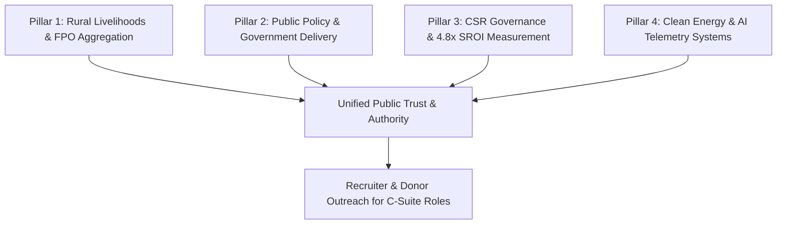

# Ramu Munugoti — Master Executive Roadmap & Omni-Domain LinkedIn Architecture
*Bridging Public Policy, Rural Development, Livelihoods, CSR, Clean Tech & Applied AI*

---

## 1. Executive Master Positioning: The Multi-Sector Architect

Ramu Munugoti’s greatest competitive moat is that he is **not a narrow single-domain specialist**. He represents an ultra-rare profile in the Indian and international development ecosystem:

```
                  ┌───────────────────────────────────────────────┐
                  │              THE MASTER IDENTITY              │
                  │        POPULATION-SCALE PROGRAM LEADER        │
                  │   & PUBLIC SYSTEMS / CSR EXECUTIVE DIRECTOR   │
                  └───────────────────────┬───────────────────────┘
                                          │
         ┌────────────────────────────────┼────────────────────────────────┐
         │                                │                                │
┌────────▼──────────────┐      ┌──────────▼────────────┐      ┌────────────▼──────────┐
│   RURAL LIVELIHOODS   │      │   PUBLIC POLICY &     │      │     CSR & DONOR       │
│     & AGRIBUSINESS    │      │  GOVERNMENT SYSTEMS   │      │ FIDUCIARY STEWARDSHIP │
├───────────────────────┤      ├───────────────────────┤      ├───────────────────────┤
│ • 50+ FPOs Federated  │      │ • Ex-NSDC (MoSDE)     │      │ • ₹45Cr+ PFMS Budget  │
│ • 20K+ Farmers        │      │ • 33 District Comm.   │      │ • 100% CAG Clearance  │
│ • +24% Price Realiz.  │      │ • DSDP Formulations   │      │ • 4.8x Audited SROI   │
│ • Post-Harvest & Cold │      │ • State Convergence   │      │ • Theory of Change    │
└────────┬──────────────┘      └──────────┬────────────┘      └────────────┬──────────┘
         │                                │                                │
         └────────────────────────────────┼────────────────────────────────┘
                                          │
                 ┌────────────────────────┴────────────────────────┐
                 │          CROSS-CUTTING EXECUTION ENGINES        │
                 ├─────────────────────────────────────────────────┤
                 │ 1. Clean Tech & Solar (PM Surya Ghar, Pumping)  │
                 │ 2. Telemetry, Python, SQL & Applied AI (ODK)    │
                 │ 3. Community Empowerment & Mentorship           │
                 └─────────────────────────────────────────────────┘
```

---

## 2. Updated Executive Headlines (Multi-Track & Targeted)

### Master Headline (Unified Omni-Sector — Recommended)
> **Director / Chief of Party — Public Policy, Rural Livelihoods & CSR | 15+ Yrs Population-Scale Programs across 59 Districts | Ex-State Lead, NSDC (MoSDE) | ₹45Cr+ Budget (100% CAG Clean) | TISS Mumbai (M.A.) + B.Tech Mechanical**  
*(218 characters)*

### Alternate 1: CSR, Philanthropy & ESG Board Track
> **Head of CSR & Social Impact | Practice Lead — Rural Development & Inclusive Value Chains | SROI 4.8x | Governed 50+ FPOs & 45K+ Livelihoods | Fiduciary Rigor (PFMS / Zero Disallowance) | TISS Mumbai + B.Tech | PMP**  
*(215 characters)*

### Alternate 2: Public Policy, CPSE & Multilateral Donor Track
> **Executive Director / Chief of Party | Public Systems Governance, Agriculture & Clean Energy Transition | USAID & World Bank Alignment | Ex-NSDC State Head | 124+ Mos Post-PG Leadership | TISS Rural Governance + B.Tech**  
*(218 characters)*

---

## 3. The 5 Core Hiring Arenas & Targeted Executive Roles

| Hiring Sector | Target Roles | Target Organizations |
| :--- | :--- | :--- |
| **1. Corporate CSR & Philanthropic Foundations** | Head of CSR, Vice President - Social Impact, Director of Programs | Tata Trusts, Reliance Foundation, Adani Foundation, ITC Mission Sunehra Kal, Mahindra Pride, Gates Foundation, Azim Premji Foundation |
| **2. Multilateral & Bilateral Donors** | Chief of Party (CoP), Deputy Chief of Party (DCoP), Senior Agriculture/Livelihoods Advisor | USAID Primes (Chemonics, DAI, Tetra Tech), World Bank, UN FAO, IFAD, UNDP, Asian Development Bank (ADB) |
| **3. Public Policy, Think Tanks & Governance Advisory** | Practice Director, Government Advisory Lead, Senior Policy Fellow | NITI Aayog, PwC/EY/KPMG Government Practices, National Livelihood Missions, Centre for Policy Research, Swaniti Initiative |
| **4. CPSEs & Statutory Institutions** | General Manager / Chief General Manager / Executive Director | NABARD, SIDBI, TRIFED, SFAC, SECI, REC, State Rural Livelihood Missions (SERP/MEPMA) |
| **5. Cleantech & Agribusiness Federations** | Chief Operating Officer (COO), Executive Director | National FPO Consortiums, International Solar Alliance (ISA), Clean Energy Access Networks, Agribusiness MNCs |

---

## 4. Multi-Pillar Content Matrix (The 360° Authority Flywheel)

To attract recruiters across **all five fields**, content rotates systematically through 4 strategic pillars:



### Pillar 1: Rural Development, Agriculture & Livelihoods
* **Field Topics:** FPO federations, smallholder market linkages, crop cluster economics, secondary agriculture, post-harvest losses, micro-irrigation.
* **Candid Practitioner Hook:** *"Why 70% of Farmer Producer Organizations (FPOs) struggle after grant funding ends—and the market-linkage blueprint that scaled our 50+ FPOs to a 24% price premium."*
* **Target Audience:** NABARD, SFAC, World Bank, Agribusiness CEOs, Philanthropy Heads.

### Pillar 2: Public Policy & Governance Convergence
* **Field Topics:** District Skill Development Plans (DSDPs), convergence between Panchayati Raj Institutions (PRIs) and District Collectors, state-level inter-ministerial execution.
* **Candid Practitioner Hook:** *"The anatomy of a ₹45 Crore public scheme: What 5 years at NSDC and 33 District Committees taught me about executing without audit disallowances."*
* **Target Audience:** NITI Aayog, Central & State Secretaries, Multilateral Mission Directors.

### Pillar 3: Corporate Social Responsibility (CSR) & Fiduciary Rigor
* **Field Topics:** Measuring 4.8x Social Return on Investment (SROI), Theory of Change (ToC), eliminating phantom beneficiaries through digital monitoring, Section 135 compliance.
* **Candid Practitioner Hook:** *"Most CSR dashboards show 'number of beneficiaries trained.' Here is why corporate boards must demand Social Return on Investment (SROI) and third-party telemetry instead."*
* **Target Audience:** CSR Committee Board Members, Corporate Managing Directors, Foundation CEOs.

### Pillar 4: Clean Energy & AI Telemetry (The Modern Execution Moat)
* **Field Topics:** Decentralized solar (PM Surya Ghar), solar irrigation pumps, AI data pipelines, ODK/KoboToolbox mobile survey telemetry.
* **Candid Practitioner Hook:** *"You cannot manage 59 districts with spreadsheets. How we deployed mobile telemetry and Python pipelines across 12,000 monthly field data points."*
* **Target Audience:** Cleantech investors, International Solar Alliance, Operations Heads.

---

## 5. Sample Ready-to-Post Thought Leadership Pieces

### Post 1 (CSR & Fiduciary Leadership):
```text
In the CSR and development sector, there is a dangerous metric that too many boards still settle for:

"Number of beneficiaries reached."

Reaching a beneficiary is an input. It is not an outcome. And it certainly isn't impact.

Over the past decade managing public and corporate allocations exceeding ₹45 Crores, here is the framework we used to transition from superficial reach to an audited 4.8x Social Return on Investment (SROI):

1. The "Zero-Phantom" Rule:
If a beneficiary’s participation cannot be verified through Aadhaar-enabled telemetry or GPS-tagged field data (ODK/KoboToolbox), it does not enter our reporting dashboard. Paper attendance registers belong in the 1990s.

2. Economic Self-Sufficiency over One-Time Handouts:
Providing a subsidised asset (like a solar micro-irrigation pump or vocational certificate) is only stage one. True ROI is measured 12 months later: Did net household income rise? Did local mandi price realization improve?

3. Total Audit Transparency:
Public and corporate capital demands the same fiduciary precision as institutional equity. Across 5 years of central skilling operations across 33 districts, maintaining 100% clean Comptroller & Auditor General (CAG) clearance required treating every rupee as an investment with an auditable milestone.

Corporate boards don’t need more glossy brochures with smiling faces. They need rigorous, quantifiable, data-backed social impact.

How does your organization audit long-term social return on investment?

#CSR #SocialImpact #SROI #PublicPolicy #Governance #CorporateResponsibility #RamuMunugoti
```

### Post 2 (Rural Development & FPO Federations):
```text
Federating 50+ Farmer Producer Organizations (FPOs) across 59 districts taught me one brutal truth:

An FPO is not a charity. It is a commercial rural enterprise.

When government schemes or donor funds treat FPOs as passive subsidy recipients, they collapse the moment working capital support expires.

To deliver a sustained 24% increase in net farmer price realization across 20,000+ farm holdings, we enforced three non-negotiable operational principles:

1. Commodity Aggregation Before Market Entry:
Individual smallholders holding 1-2 acres have zero bargaining power with large institutional buyers. Clustered aggregation at the mandal and district level created bulk volumes that bypassed predatory middlemen.

2. Infrastructure Sizing (Hardware Reality):
You cannot scale horticultural value chains without cold-chain storage and primary grading assets. As a mechanical engineer, I worked directly on sizing decentralized solar cold rooms and micro-irrigation pumps to ensure the machinery matched local power availability and crop harvest cycles.

3. Institutional Credit Linkages:
FPOs need timely credit lines for harvest-season procurement. Building formal balance sheets and credit histories unlocked institutional financing from NABARD and regional commercial banks, replacing informal high-interest debt.

Rural development doesn't happen through theoretical workshops. It happens through cold-chain logistics, balance-sheet discipline, and fair market access.

#RuralDevelopment #Agribusiness #FPO #Livelihoods #SupplyChain #Agriculture #PublicPolicy
```

---

## 6. The Omnichannel LinkedIn Agent Architecture

```
                                  ┌─────────────────────────────┐
                                  │   CONTENT RADAR & INGEST    │
                                  └──────────────┬──────────────┘
                                                 │
            ┌───────────────────┬────────────────┼───────────────────┐
            │                   │                │                   │
     ┌──────▼──────┐     ┌──────▼──────┐  ┌──────▼──────┐     ┌──────▼──────┐
     │ CSR & MCA   │     │ NABARD, SFAC│  │ NITI Aayog, │     │ MNRE Solar, │
     │ Regulations │     │ & FPO Data  │  │ MoSDE News  │     │ Clean Tech  │
     └──────┬──────┘     └──────┬──────┘  └──────┬──────┘     └──────┬──────┘
            │                   │                │                   │
            └───────────────────┼────────────────┴───────────────────┘
                                │
                  ┌─────────────▼─────────────┐
                  │    RAMU'S VOICE ENGINE    │
                  │  (Candid & Tactical +     │
                  │   Verified Impact Data)   │
                  └─────────────┬─────────────┘
                                │
             ┌──────────────────┴──────────────────┐
             │                                     │
    ┌────────▼────────┐                   ┌────────▼────────┐
    │ 4 Weekly Drafts │                   │ 20 High-Value   │
    │ (Rotating across│                   │ Executive Lead  │
    │  all 4 Pillars) │                   │ Engagements     │
    └────────┬────────┘                   └────────┬────────┘
             │                                     │
             └──────────────────┬──────────────────┘
                                │
                  ┌─────────────▼─────────────┐
                  │ TELEGRAM / MOBILE REVIEW  │
                  │   [Approve] [Edit] [Hold] │
                  └─────────────┬─────────────┘
                                │
                  ┌─────────────▼─────────────┐
                  │ AUTOMATED LINKEDIN LAUNCH │
                  └───────────────────────────┘
```
